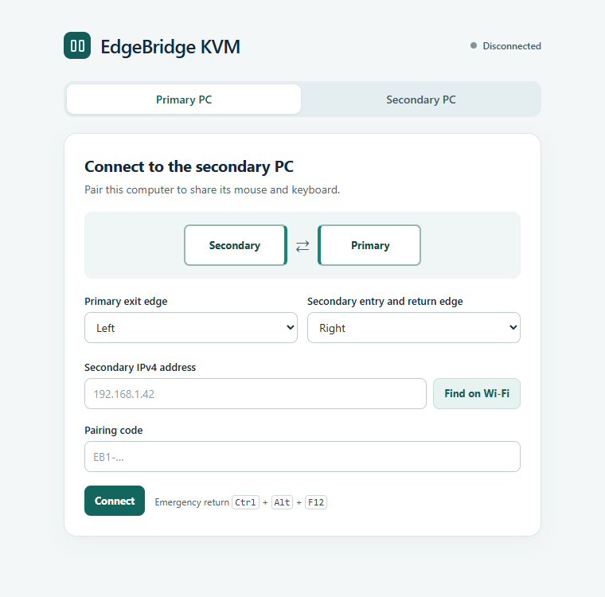

# EdgeBridge KVM

EdgeBridge shares one mouse and keyboard between two Windows computers on the same local network. Both PCs keep their own displays, apps, and Windows sessions. EdgeBridge sends input events over a direct TLS connection.

| Secondary PC | | Primary PC |
| --- | :---: | --- |
| **Right edge** | ⇄ | **Left edge** · mouse and keyboard connected here |

Move the cursor to the **left edge of the primary PC**. It enters near the right edge of the secondary PC. Move into the secondary display first, then push against its **right edge** to return. Press **Ctrl + Alt + F12** on the primary keyboard to return immediately.



## Install and pair

1. On each PC, run the x64 setup executable from [Releases](../../releases). Use Windows 11 x64 with Microsoft Edge WebView2 and a mouse that reports relative movement. Keep the app open on both PCs.
2. On the left PC, select **Secondary PC**, then **Start receiver**. If Windows Firewall prompts, allow EdgeBridge on private networks.
3. On the right PC, select **Primary PC**. Choose the receiver discovered on Wi-Fi or enter its IPv4 address manually. Use `ipconfig` on the secondary PC to find the IPv4 address for its Wi-Fi adapter if multiple interfaces are present.
4. Transfer the pairing code privately from the secondary PC to the primary PC. Paste it into **Pairing code**, keep **Primary exit edge = left** and **Secondary entry and return edge = right**, and select **Connect**.
5. Check that both PCs show **Connected**. The primary PC displays the measured LAN round-trip time. Use **Disconnect** or **Stop receiver** to end the session.

The v0.1 installer is unsigned. Check its SHA-256 against the published release checksum if you download a copy from somewhere other than the release page. WebView2 may require a one-time download during installation if it is missing.

EdgeBridge v0.2.0 and later check GitHub Releases for signed updates on startup. Upgrading from v0.1.0 requires running the new installer once on each PC. [Windows updates](docs/updates.md)

## Share clipboard

1. Run EdgeBridge v0.3.0 or later on both PCs. If already connected, select **Disconnect** on the primary PC and **Stop receiver** on the secondary PC.
2. Turn on **Share clipboard on both PCs** on each PC. The checkbox starts unchecked when the app opens and is locked while the sender or receiver is running.
3. On the secondary PC, select **Start receiver**. Use its new pairing code to reconnect from the primary PC.
4. Confirm that EdgeBridge shows **Clipboard sharing active**. Copy fresh text with Ctrl+C, switch PCs, then paste into Notepad with Ctrl+V.

**Connected** confirms the mouse and keyboard session. If **Clipboard sharing active** is missing or EdgeBridge says **Clipboard sharing unavailable on this connection**, check the version and checkbox on both PCs, then restart the receiver and reconnect. Copy again after sharing becomes active to send the new clipboard contents.

Clipboard sharing sends Unicode text, compatible Windows bitmap images and up to 32 regular files copied from a local drive. Each transfer can be up to 64 MiB. Folders, cloud placeholders and network paths are outside this version. Paste files before disconnecting. The receiving PC makes a temporary copy so Explorer can paste it into the chosen destination.

## Features and current limits

- Mouse movement, five mouse buttons, vertical and horizontal wheel input, and keyboard scan codes.
- Configurable exit and entry edges on the Windows primary monitor of each computer. Position along the edge is proportional across resolutions and Windows display scale settings. Pointer movement uses relative mouse counts and can feel different from Windows pointer acceleration.
- IPv4 discovery via UDP broadcast with a manual address fallback. Guest Wi-Fi and client isolation can prevent direct connections. The receiver uses TCP port **46387** and UDP port **46388**.
- In-session reconnection to the configured IPv4 address. TCP failures and heartbeat timeouts restore local input. Automatic reconnection uses the current pairing code until either app is stopped or the receiver is restarted.
- Transition waits for held keys and mouse buttons to be released. Emergency return and orderly disconnect send releases for remote keys and buttons still held. Dragging across screens is outside this release.
- Normal Windows user-session permissions apply. Windows can block input to elevated apps, the sign-in screen, and secure desktops. Scan codes follow the secondary PC’s active keyboard layout. Absolute pointing devices and applications that require raw hardware input are outside this release.

## Pairing and privacy

Starting the receiver explicitly enables one connected client at a time. The pairing code contains a randomly generated 256-bit invitation secret and a fingerprint of the receiver’s temporary TLS certificate. The primary verifies the fingerprint before sending the secret over TLS 1.3. Discovery only proposes addresses and does not grant control. Keep the code private and stop the receiver to revoke it. Starting it again generates a new code.

Key and mouse events are processed in memory during forwarding. EdgeBridge has no telemetry and sends neither input events nor screenshots to external servers. The app saves the selected edge settings locally. Pairing material lives in memory for the session.

## Build from source

Install [the Windows prerequisites for Tauri](https://v2.tauri.app/start/prerequisites/), including a stable Rust MSVC toolchain, Visual Studio C++ Build Tools, the Windows SDK, WebView2, and Node.js 22.12 or newer. Run these commands from the repository root in an x64 developer shell.

```powershell
npm ci
npm run tauri dev
```

For a production installer, run `npm.cmd run tauri build -- --bundles nsis --ci -- --locked`. The setup executable is written under `src-tauri/target/release/bundle/nsis/`.

## Architecture and validation

The Tauri commands in `service.rs` own a single session and expose status to the React UI. `discovery.rs` handles LAN discovery, `pairing.rs` pins the TLS receiver, and `network.rs` runs the framed Tokio session with bounded writes and heartbeats. `state.rs` owns the control transitions and display geometry. `native/capture.rs` handles Raw Input and Windows low-level hooks on a dedicated message thread. `receiver.rs` tracks remote input state and uses `native/injection.rs` to deliver Windows input and release held keys and buttons on session exit.

The Windows CI workflow checks TypeScript, builds the UI, runs Rust format and lint checks, tests protocol and control logic, and builds the NSIS installer. See [Validation](docs/validation.md) for automated coverage and the two-computer test procedure.

See the [architecture](docs/architecture.md), [benchmark](docs/benchmark.md), [open-source comparison](docs/open-source-comparison.md), [threat model](docs/security/threat-model.md), and [V2 readiness plan](docs/v2-readiness.md).

Contributions are welcome. See [CONTRIBUTING.md](CONTRIBUTING.md). EdgeBridge KVM is released under the [MIT License](LICENSE).
