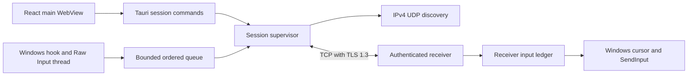

# Architecture

EdgeBridge is a Windows user-session input bridge. The **primary PC is on the right**. Its left edge hands control to the secondary PC's right edge, and that same secondary edge returns control. The settings allow other edges. Each PC uses its Windows primary monitor.

| Boundary | Owner | Properties |
| --- | --- | --- |
| UI and local permissions | `src/main.tsx`, `capabilities/main.json`, `service.rs` | Commands are scoped to the local main WebView. Rust validates inputs and serializes service ownership. The UI polls a snapshot every 250 ms. Role and edge preferences are persisted. |
| Pairing and discovery | `pairing.rs`, `discovery.rs`, `network.rs` | UDP advertises an address, name and public certificate pin. A separate TLS ALPN negotiates visual confirmation. Both PCs derive an eight-digit comparison value from their TLS exporter, and both users must accept before the receiver issues a 256-bit credential. Manual pairing remains compatible with earlier versions. |
| Transport and lifecycle | `network.rs`, `session_health.rs`, `protocol.rs` | Fixed-size v1 frames, TCP_NODELAY, bounded TLS writes and one authenticated controller. Eight pending negotiations are allowed, each with a three-second limit. Only the selected controller receives Ready. |
| Clipboard sharing | `network.rs`, `clipboard.rs` | Both peers opt in before connecting. TLS ALPN negotiates support, then a separate TLS stream on the receiver's TCP port is authenticated with a fresh token sent over the control connection. Clipboard transfers run alongside the input stream. The UI reports clipboard availability separately from control connectivity. |
| Capture and control | `native/capture.rs`, `state.rs` | Dedicated Win32 message thread. Low-level hooks handle keyboard, buttons and suppression. Raw Input supplies relative mouse counts when forwarding. The normalized edge coordinate is independent of the peer's resolution. |
| Emulation | `receiver.rs`, `native/injection.rs` | The receiver owns the active edge and pressed-input ledger. SetCursorPos places the pointer and SendInput delivers buttons, wheels and scan codes. The ledger releases held input on return, orderly stop or session teardown. |

## Session and control transitions

Discovery returns address candidates. A successful handshake changes the sender from offline to local. A configured edge crossing enters remote control only when input is released. The receiver arms return after inward movement to avoid bouncing from entry momentum. Returning, invoking the emergency shortcut or closing the authenticated connection restores local control. A reconnect starts locally and requires a fresh crossing. Windows secure desktops and elevated targets follow normal Windows permission rules.

The capture queue holds up to 1,024 frames. An overrun closes the session. On dequeue, a frame aged 200 ms or more also ends the session so that dropping a release in isolation cannot leave a key or button down remotely. This age applies to the sender's queue and excludes network transit after a frame has been sent. The sender keeps one heartbeat probe outstanding and accepts only its matching response inside the 1.25-second lease. The receiver also closes idle sessions after 1.25 seconds. Normal TCP failure can close sooner.

## Audit of the MVP

- **Capture and injection.** The implementation follows Win32's dedicated message thread and normal user-integrity input APIs. The geometry tests cover edge mapping across differently sized rectangles. Hardware Raw Input order relative to the low-level click hook, special keys, touchpads, mixed DPI and real Windows focus require the [physical matrix](validation.md). The cursor remains at the primary edge until local control returns.
- **Network and reliability.** The baseline blocked all later accepts while one TLS negotiation ran. Its heartbeat accepted every Pong as fresh. Its bounded FIFO capped allocation but could still carry old input during link degradation. The post-MVP changes address those three cases without changing frame tags or payloads.
- **Ownership and memory.** A session generation protects status from cancelled tasks. The receiver and capture thread each own their live input state. Pressed keys are transient state, and the queue is bounded. Hook teardown posts a quit message and joins the worker. A real test is needed for device removal, Windows session lock, event-thread shutdown and sustained high-rate hardware input.
- **Frontend and build.** The build and native UI smoke checks exercise Tauri commands, local preference persistence and listener cleanup. Polling remains simple at two nodes. A push-based status channel is useful if idle measurements justify it or V2 adds more frequent state updates.
- **Coverage.** Protocol validation, handshake pin/token rejection, partial handshake concurrency, liveness, stale-input rejection, mock injection cleanup and display geometry have automated coverage. See [benchmark scope](benchmark.md) and [validation](validation.md).

Rollback each post-MVP change independently in Git. The v0.1.0 wire protocol remains compatible, and the patch introduces no database or preference migration. The **Stop receiver** action closes the local session and revokes its invitation.
